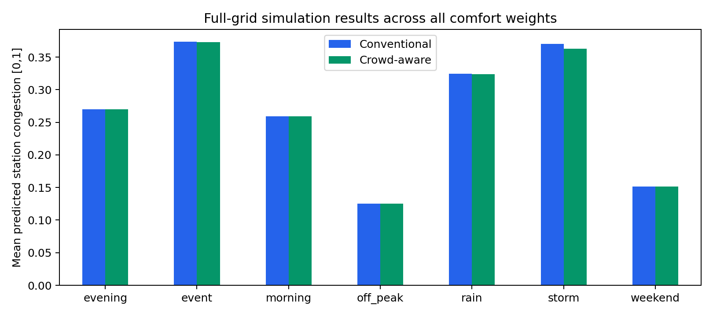

# Smart Public Transport System: Crowd-Aware Route Optimization

CS201 Software Engineering, Indian Institute of Information Technology Lucknow.

Contributors (preserved from the original configuration): Dhruvika Rawat (LCB2025012), Ganga Kaur (LCI2025033), Harshita Punia (LCB2025011), Ocean Kesarwani (LCI2025019).

## Problem and motivation

Conventional travel-time routing can recommend a path through crowded stations because congestion is absent from its objective. This project predicts station congestion and lets a commuter compare the quickest simulated itinerary with a route that trades travel time for lower accumulated crowd discomfort. The objective is to reduce predicted station exposure while making added time visible.

**Simulation disclosure:** All 22,800 historical station-hour rows are synthetic. The 20-station network has fictional lines inspired by Lucknow and is not an operational route guide. There are no observed passenger measurements, live sensors, seating guarantees or demonstrated real-world congestion reductions.

## Supported implementation

The authoritative pipeline is `src/pipeline` → `src/model` → `src/routing` → `src/ui/app.py`. The original alternative classifier, network and tests are preserved under `legacy/` for historical reference. They are outside the supported package and acceptance suite. `app/streamlit_app.py` forwards to the same supported UI.

```text
Synthetic history CSV -> validation -> cyclic scenario features -> selected regressor
Station/route CSV -> MultiDiGraph -> station/line weighted Dijkstra -> comparison -> Streamlit
```

The UI selects origin, destination, hour, weekday, weather, event and preference. It displays every station prediction, both itineraries, duration including transfers, average/max congestion, high-station counts, signed reduction and time delta. An interactive native Streamlit/Altair network chart supports pan, zoom and hover without external map tiles or CDNs.

## Install and run

Use Python 3.11. Windows PowerShell:

```powershell
git clone https://github.com/oceankesarwani/Smart-transport-system.git
cd Smart-transport-system
python -m venv .venv
.\.venv\Scripts\python.exe -m pip install -r requirements.txt
.\.venv\Scripts\python.exe -m src.model.train
.\.venv\Scripts\python.exe -m streamlit run src/ui/app.py
```

Linux/macOS:

```bash
python3.11 -m venv .venv
.venv/bin/python -m pip install -r requirements.txt
.venv/bin/python -m src.model.train
.venv/bin/python -m streamlit run src/ui/app.py
```

Once the environment is activated, the commands below use `python`. The app needs no paid services, credentials or network access after installation. If an artifact is missing/incompatible, the UI shows the training command. Only load the trusted repository artifact or your own retrained file.

## Data and model reproduction

```bash
python data/generate_dataset.py
python -m src.model.train
python quick_check.py
```

The seed-42 generator uses assumed station/time factors, weather, events and random noise. It creates 60 days from 2026-09-20 to 2026-11-18, 19 hours per day. It does not ingest sensors or surveys. Training sorts timestamp and station, then splits complete days 60/20/20 (13,680/4,560/4,560 rows). Features are cyclical hour/day, weekend, derived peak, one-hot station/weather, and event. Inflow, outflow, target, congestion category and generated delay are excluded. Weather and event inputs are hypothetical known scenarios.

Historical mean, Ridge, Random Forest and Gradient Boosting compete on validation RMSE. The selected architecture is refitted on train+validation, then evaluated once on final held-out dates. Random seeds and model parameters are fixed in code. The artifact stores a schema and Scikit-learn version.

Selected model: **Random Forest**. Held-out synthetic test: MAE **0.008378**, RMSE **0.012473**, R² **0.973181**. See [full model metrics](results/model_metrics.json). This measures this simulator, not real-world prediction accuracy.

## Routing and engineering trade-offs

For edge e ending at v, the weighted cost is:

```text
base_minutes(e) + 4 * line_change + 2.5 * preference * P(predicted_congestion(v))
P(rho) = 0                          if rho <= 0.35
         8 * (rho - 0.35)          if 0.35 < rho <= 0.70
         2.8 + 35*(rho-0.70)^2     if rho > 0.70
```

This continuous nondecreasing curve is an assumed discomfort penalty, not measured delay. All inputs are checked for finite, non-negative cost domains. The baseline sets preference to zero with identical transfer assumptions. Total duration includes a 4-minute allowance per line change, with no initial waiting time.

Weighted-sum Dijkstra is not Pareto-front search. State is `(station,last_line)` so parallel lines and transfer choices remain correct. The heap counter safely breaks equal-cost ties. An adjacency list supports sparse parallel routes in O(V+E) storage. BFS cannot handle unequal costs; A* would need a justified admissible heuristic; reinforcement learning adds unnecessary training complexity here. Modular components isolate validation, ML, graph search and UI. Cyclical time features remove clock wrap discontinuities. The selected model is justified by validation results rather than a preselected claim.

For S expanded states and A expanded transitions, lazy-heap search is O(A log A), plus O(A*S) time and memory from copied path lists in this implementation. S is at most 1+V*L; A at most E*(L+1). These bounds include station/line expansion and path storage. A future predecessor-link implementation could reduce memory.

## Reproducible route experiments

```bash
python -m scripts.benchmark
```

The predefined full grid includes 7 regimes (morning, evening, off-peak, weekend, rain, storm, event), every 380 ordered distinct station pair, and preferences 0/1/2/5: **10,640 comparisons**. No unfavorable rows are discarded. [CSV](results/routing_benchmark.csv), [summary](results/routing_summary.json).

| Measurement | Actual simulation result |
|---|---:|
| Cases with lower average exposure | 4.02% |
| Cases with equal exposure | 95.67% |
| Cases with worse exposure | 0.31% |
| Unchanged itineraries | 95.67% |
| Mean per-query signed reduction | 0.333% |
| Mean additional duration | 0.186 min |
| Mean route-pair timing, excludes prediction | 0.909 ms |
| 95th percentile route-pair timing | 2.173 ms |
| Mean network prediction across seven batches | 23.157 ms |

Timing values are local single-run measurements and will vary. Mean percentage reduction averages the individual ratios. It differs from reduction in aggregate mean exposure.



**Reliable demonstration:** S04 → S14, Thursday, 18:00, Storm, event off, preference 2. Baseline S04→S01→S12→S14: 22 min, exposure 0.405926. Recommendation S04→S18→S15→S14: 25 min, exposure 0.322975. Signed reduction 20.435%, one transfer in each. No high-congestion station on either route. This is a selected example after evaluating the whole grid, not a typical aggregate gain.

Exposure is arithmetic mean of predicted station congestion including endpoints. Maximum and high-station count (rho>=0.70) use the same visits. Reduction is 100*(baseline-smart)/baseline, signed; a zero baseline returns 0 by convention. Duration is sum(edge minutes)+4*transfers. The optimization minimizes accumulated penalty, so average exposure can worsen. Predictions are one departure-time snapshot.

## Testing and stopping decision

```bash
python -m pytest --cov=src.pipeline --cov=src.model --cov=src.routing --cov-branch --cov-fail-under=90 --cov-report=json:results/coverage.json --junitxml=results/junit.xml
```

Actual recorded suite: **74 passed**. Statement coverage **93.62%**, branch coverage **95.00%**, combined **94.02%**. Routing and cost functions have 100% statement/branch coverage. Denominator includes ingestion, prediction, routing and the training CLI module; UI/build/benchmark scripts and legacy source are excluded. [Coverage](results/coverage.json), [JUnit](results/junit.xml), [per-test report](results/test_report.csv).

Selection methods: equivalence partitioning (valid/invalid inputs), boundary value analysis (thresholds/hour endpoints/zero weight), transfer/preference decision tables, error guessing (NaN, broken artifacts, missing/duplicate data), branch and independent routing paths. Random controlled graphs are cross-checked against a separately constructed NetworkX station/line graph. Streamlit AppTest covers render and user interaction. Regression cases cover every significant fixed routing/model defect.

Exit criteria: all required cases pass; no known critical/high unresolved defect; >=90% statement coverage of measured core; meaningful routing/cost branch coverage; all eight FRs traced; complete app workflow; reproducible benchmark; verified setup and documents. See [test decision](docs/TEST_REPORT.md) and SRS. No Harlan Mills fault-seeding or Musa failure-intensity experiment is claimed.

CI runs the same training, coverage suite and benchmark on Windows and Ubuntu. Check the actual remote run before claiming it is green. The development process used baseline reproduction, incremental fixes and regression tests, not a claim of having followed TDD from the project's start.

## Documentation and generation

- [SRS PDF](docs/SRS.pdf), [editable Word](docs/SRS.docx), [editable text](docs/SRS.md)
- [Exactly five-slide presentation](docs/presentation.pptx), [presentation PDF](docs/PPT.pdf)
- [Viva preparation](docs/VIVA_PREPARATION.md), [demo and 10-minute script](docs/DEMO_SCRIPT.md)
- [Audit and baseline failures](docs/AUDIT.md), [test report](docs/TEST_REPORT.md)

```bash
python -m scripts.build_diagrams
python -m scripts.build_documents
python -m scripts.build_guides
python -m scripts.build_slides
```

The SRS builder uses python-docx/ReportLab and reads measured JSON/CSV. The editable deck is authored with the Codex bundled Artifact Tool. `scripts/build_slides.py` locates that runtime or accepts `CODEX_ARTIFACT_RUNTIME`; its JS source and slide content are committed. On Windows, run `powershell -File scripts/export_office.ps1 -RenderSrs` to export the five-slide PDF and verify the DOCX through installed Microsoft Office. On Linux with LibreOffice, use `libreoffice --headless --convert-to pdf --outdir tmp/render docs/presentation.pptx` and copy the resulting PDF to docs/PPT.pdf. The checked-in files are ready to present without regeneration or Codex.

## Repository layout

```text
src/pipeline/      validated CSV ingestion
src/model/         features, candidate selection and persistence
src/routing/       graph, cost, line-state search and metrics
src/ui/app.py      authoritative dashboard
app/               forwarding compatibility entrypoint
data/              synthetic history, illustrative topology, generator
models/            current versioned local predictor
scripts/           benchmark and reproducible artifact builders
tests/             authoritative acceptance and regression suite
results/           machine-readable experiment/test evidence and charts
docs/              SRS, five-slide deck, viva and demo
legacy/            preserved alternative source, tests and old artifacts
```

## Limitations

Small synthetic network and patterns, mostly below the high-congestion threshold; no operational generalization shown. Scenario weather/events are assumptions. The model does not consider timetables, changing crowd along the trip, capacity constraints or missed boarding. Preference has no maximum-detour guarantee. The objective differs from mean exposure, and adverse cases are reported. Meaningful deployment requires observed data, calibrated penalties and external validation. This is custom numerical prediction and graph search, with no LLM or ChatGPT API.
